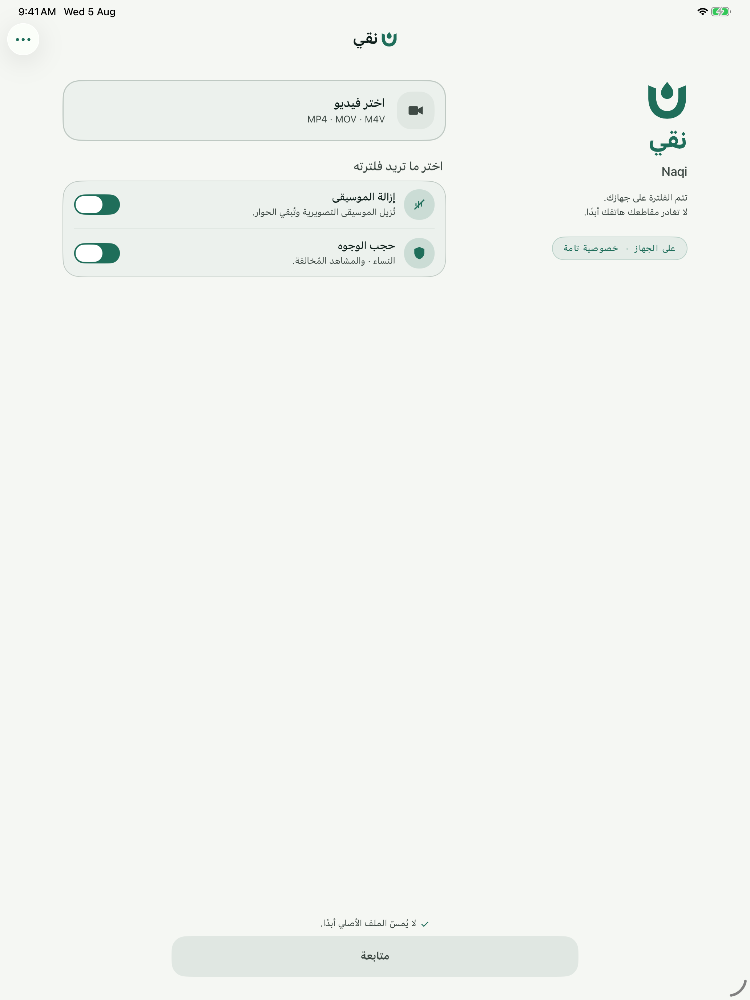
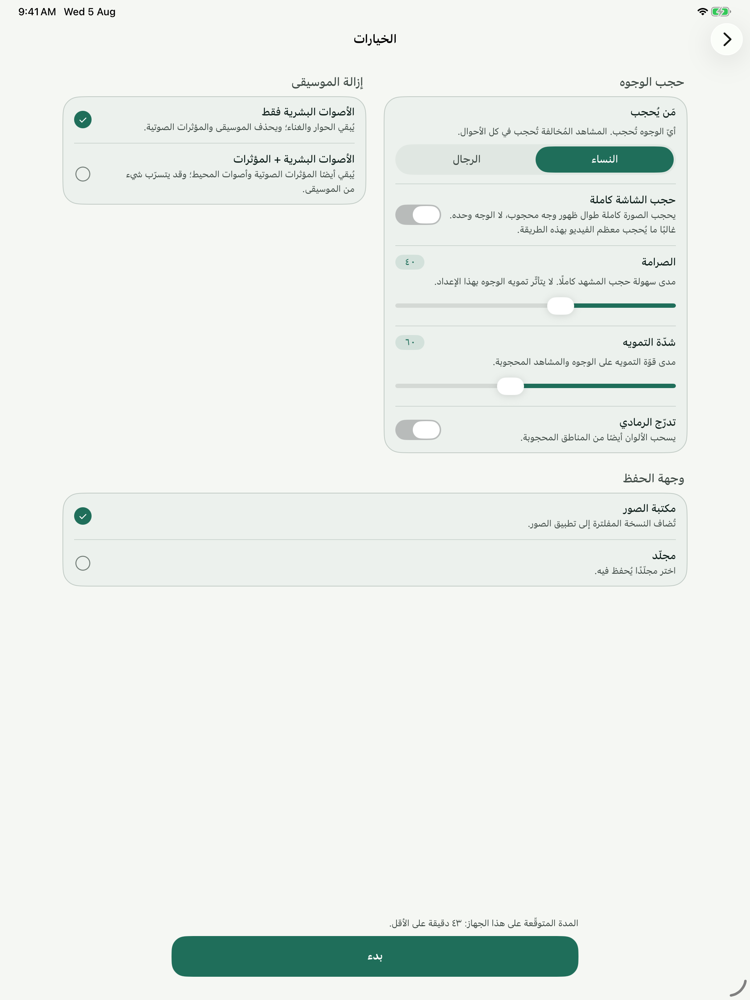
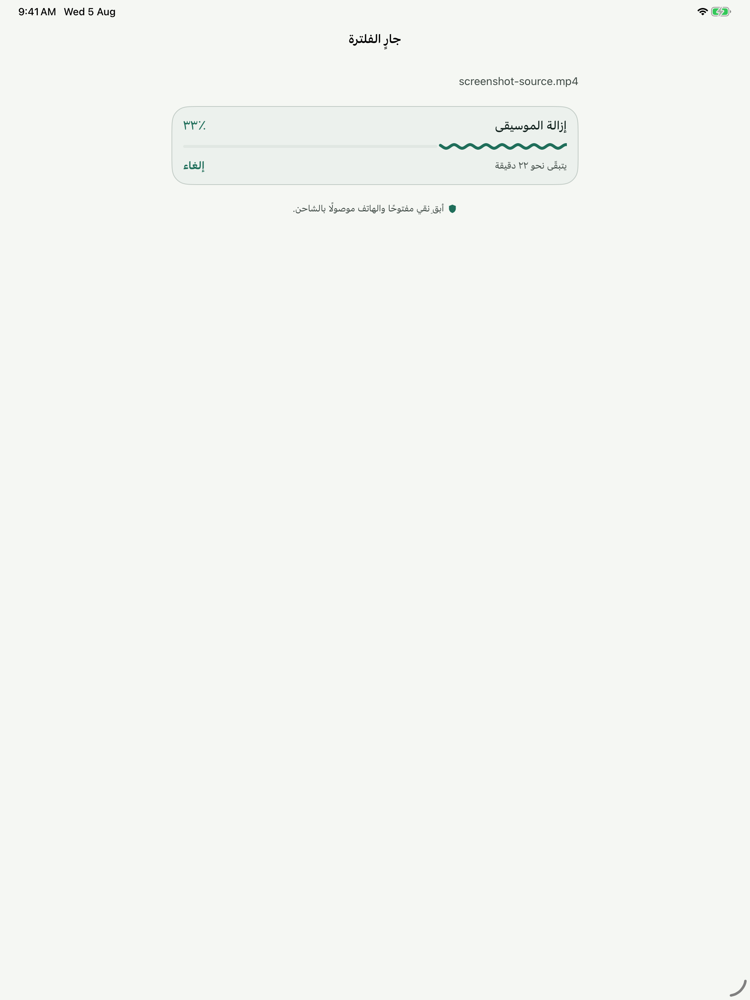
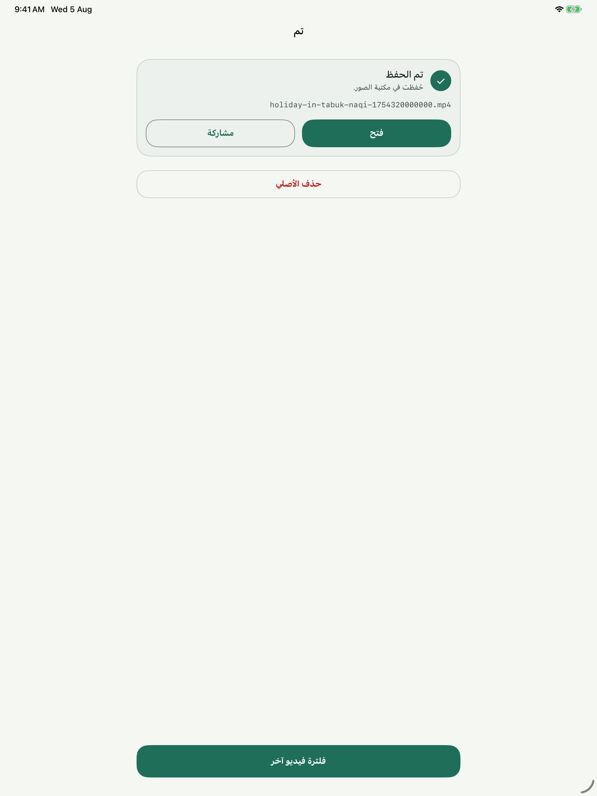

<p align="center">
  
</p>

<h1 align="center">نقي — فلتر الفيديو الحلال</h1>

<p align="center">
  تطبيق لآيفون وآيباد وماك يفلتر الفيديو <b>على جهازك</b>: يزيل الموسيقى من الصوت ويحجب الوجوه أو الأجسام في الصورة.<br>
  بلا حسابات، بلا رفع. والملف الأصلي لا يُمَسّ.
</p>

<p align="center">
  <a href="https://apps.apple.com/app/id6798173054"></a>
  <a href="LICENSE"></a>
  
  
</p>

<p align="center">
  <a href="README.md">English</a> · <b>العربية</b>
</p>

<p align="center">
  🤖 متوفر أيضًا على أندرويد: <a href="https://github.com/haithamassoli/NaqiHalalVideoFilter"><b>نقي لنظام أندرويد</b></a>
</p>

<p align="center">
  
  
  
  
  
</p>

<div dir="rtl">

**نَقيّ** تعني الطاهر الخالص.

## ماذا يفعل

عمليتان مستقلتان، تعملان منفردتين أو معًا:

- **إزالة الموسيقى** — نموذج HTDemucs يفصل الصوت إلى مسارات ويُبقي ما تختاره أنت
  (`الأصوات` فقط، أو `الأصوات + المؤثرات` للاحتفاظ بالمؤثرات الصوتية مقابل تسرّب بعض الموسيقى).
  يبقى الكلام والغناء، لأنهما عند نموذج الفصل شيء واحد. ويتحقق نموذج YAMNet أولًا من وجود موسيقى،
  فتُتخطّى المقاطع الخالية منها.
- **حجب الأشخاص** — يكتشف Vision الوجوه ويتتبعها، ويحدد تصويتُ نموذج InsightFace `genderage`
  جنسَ كل مسار. أنت تختار **من** يُحجب: الجميع أو النساء أو الرجال. ومن لم يتضح تصنيفه يُحجب.

التغطية: **الوجه / الجسم / الجسم بدقة**، والوجه هو الافتراضي. خيارا الجسم يضيفان YOLO11n-seg بمعدل
10 إطارات في الثانية فتصبح الفلترة أبطأ: «الجسم» يحجب مستطيلًا حول الشخص، و«الجسم بدقة» يحجب حدود
الشخص ويُبقي الخلفية ظاهرة.

وبمعزل عن الأشخاص، يوجد **كاشف مشاهد غير لائقة** اختياري يحجب الإطار كاملًا ما دام يعمل، مع حجب
مسبق قبل اللقطة حتى لا يفلت أول إطار.

قابل للضبط: من يُحجب، ودرجة التمويه، ولون مصمت بدل التمويه (5 ألوان)، والتدرّج الرمادي، ووضع الإطار
الكامل، وتشغيل كاشف المشاهد وصرامته (0–100).

وأيضًا:

- **الاستيراد من أي مكان** — الصور أو الملفات أو قائمة المشاركة، أو السحب والإفلات على ماك.
- **التنزيل برابط** — الصق رابط فيديو أو شاركه، فينزّله نقي ثم يفلتره. اختر الجودة
  (الأفضل / 1080p / 720p / 480p / صوت فقط). يُحفظ التنزيل في مجلد معزول ولا يُنشر إلا بعد الفلترة.
- **الملفات الصوتية أيضًا** — إزالة الموسيقى تعمل على الصوت دون فيديو.
- **استئناف المهام** — يُحفظ التقدّم أولًا بأول، فتكمل المهمة المنقطعة من حيث توقفت.
  ويعرض نشاط مباشر (Live Activity) المهمة الجارية على شاشة القفل.
- **العربية والإنجليزية**، مع تخطيط كامل من اليمين إلى اليسار بالعربية.

الصيغ المدعومة: كل ما تقرؤه مفككات Apple (MP4 وMOV وM4V وغيرها)، إضافة إلى WebM الذي يُحوَّل أولًا
إلى نسخة عمل MP4. صيغة MKV غير مدعومة.

## الخصوصية

تُعالَج الملفات المستوردة محليًا. لا يُستخدم الإنترنت إلا لتنزيل فيديو من رابط تعطيه أنت. لا يُرفع
شيء، ولا يلزم حساب. تجد بيان الخصوصية كاملًا في شاشة «حول التطبيق».

## التثبيت

<a href="https://apps.apple.com/app/id6798173054"></a>

مجاني على App Store لآيفون وآيباد. أما نسخة ماك فتُبنى من المصدر (انظر أدناه).

**المتطلبات:** iOS / iPadOS 18 فأحدث، أو macOS 15 فأحدث لنسخة ماك.

## البناء من المصدر

تحتاج إلى جهاز ماك عليه Xcode وحزم تطوير iOS 18 وmacOS 15. يستخدم المشروع Swift 6 ويجلب
ONNX Runtime والإصدار المصغّر من FFmpegKit عبر Swift Package Manager.

النماذج والخطوط مستثناة من Git، فالنسخة الجديدة تحتاج ثلاثة أشياء أولًا:

1. **النماذج من مشروع أندرويد.** انسخ
   [NaqiHalalVideoFilter](https://github.com/haithamassoli/NaqiHalalVideoFilter) وجهّز نماذجه،
   ثم وجّه السكربت إلى مساره:

   ```sh
   python3 -m pip install numpy onnx onnxruntime
   NAQI_ANDROID_REPO=/path/to/NaqiHalalVideoFilter ./scripts/fetch-models.sh
   ```

2. **نموذج الأشخاص بصيغة Core ML.** يتحقق السكربت من بصمات الرسم الحسابي والأوزان قبل التجميع:

   ```sh
   uv run --python 3.12 --with ultralytics==8.4.29 --with torch==2.7.0 \
     --with torchvision==0.22.0 --with numpy==2.2.6 --with coremltools==9.0 \
     scripts/fetch-person-model.py
   ```

3. **الخطوط.** ضع ملفات خط Thmanyah Sans المرخّصة بأوزان `Regular` و`Medium` و`Bold` في
   `NaqiShared/Fonts/`، بالأسماء `thmanyahsans-Regular.otf` و`thmanyahsans-Medium.otf`
   و`thmanyahsans-Bold.otf`.

ثم افتح `naqi.xcodeproj`، واختر مخطط `naqi`، وشغّله على محاكي iOS أو جهاز ماك. ومن الطرفية:

```sh
xcodebuild -project naqi.xcodeproj -scheme naqi \
  -destination 'generic/platform=iOS Simulator' \
  -derivedDataPath build.noindex/README CODE_SIGNING_ALLOWED=NO build
```

راجع شروط النماذج والخطوط قبل الحصول عليها أو توزيعها؛ التفاصيل في [`NOTICE`](NOTICE).

## كيف يعمل

التحليل والإخراج مرحلتان منفصلتان. فتصويت الجنس يحتاج مسار الوجه كاملًا قبل إخراج أول إطار منه،
والحجب المسبق لكاشف المشاهد يحتاج خطه الزمني قبل الترميز.

**المرحلة الأولى (فك ترميز فقط)** تأخذ عينات لكاشف المشاهد بمعدل 5 إطارات في الثانية وللوجوه بمعدل 10،
وتحدد جنس كل مسار وجه من 5 لقطات أمامية كحد أقصى، وتُخرج قائمة تحرير (EDL): فترات الحجب ومناطق كل إطار.

**المرحلة الثانية** تطبّق قائمة التحرير عبر Core Image وترمّز بـ AVAssetWriter على المرمّز العتادي.
مهام الحجب وحده تمرّر الصوت كما هو، ومهام إزالة الموسيقى وحدها تنسخ عينات الفيديو الأصلية دون إعادة ترميز.

البنية مطابقة لتطبيق أندرويد. التفاصيل في
[`docs/prd-video-filter-apple.md`](docs/prd-video-filter-apple.md)، ويتضمن
[تقرير دمج iOS](docs/benchmarks/integration-ios.ar.md) مقارنة الأداء على الفيديوهات الكاملة
وحدود التغطية المتبقية.

### النماذج

| النموذج | المهمة | الحجم | بيئة التشغيل |
| --- | --- | --- | --- |
| [htdemucs](https://github.com/facebookresearch/demucs) (مقطع 2.6 ث، fp32) | فصل الموسيقى عن الأصوات | 173 MB | ONNX Runtime |
| [YAMNet](https://github.com/tensorflow/models/tree/master/research/audioset/yamnet) | «هل هنا موسيقى؟» قبل الفصل | 16 MB | ONNX Runtime |
| [nsfw_model](https://github.com/GantMan/nsfw_model) MobileNetV2 1.4-224 | كاشف المشاهد غير اللائقة | 17 MB | ONNX Runtime |
| [InsightFace](https://github.com/deepinsight/insightface) `genderage` (buffalo_l) | تصويت الجنس لكل مسار وجه | 1.3 MB | ONNX Runtime |
| Apple Vision | كشف الوجوه وتتبعها | — | النظام |
| [YOLO11n-seg](https://docs.ultralytics.com/models/yolo11) (FP16، 640×640) | مستطيلات الأجسام وحدودها (اختياري) | 5.8 MB | Core ML |

شروط ترخيص كل نموذج في [`NOTICE`](NOTICE).

## الدقة، بصراحة

النماذج جيدة لكنها ليست كاملة. قد لا يُحسم وجه لم يظهر من الأمام قط، ويخطئ تصويت الجنس في الوجوه
الجزئية والأطفال. وقد تفوت الفلترة وجهًا أو مشهدًا، فراجع النتيجة قبل مشاركتها.

إن أردت أشد نتيجة ممكنة، فاختر **الجميع** بدل جنس محدد، وفعّل وضع الإطار الكامل.

## الترخيص

تخضع الشيفرة التي كتبها مطوّر نقي [للترخيص](LICENSE) الذي يسمح **بالاستخدام الشخصي غير التجاري**.
وتخضع شيفرات الأطراف الثالثة والخطوط وأوزان النماذج لشروط مستقلة موضّحة في [`NOTICE`](NOTICE).

</div>
