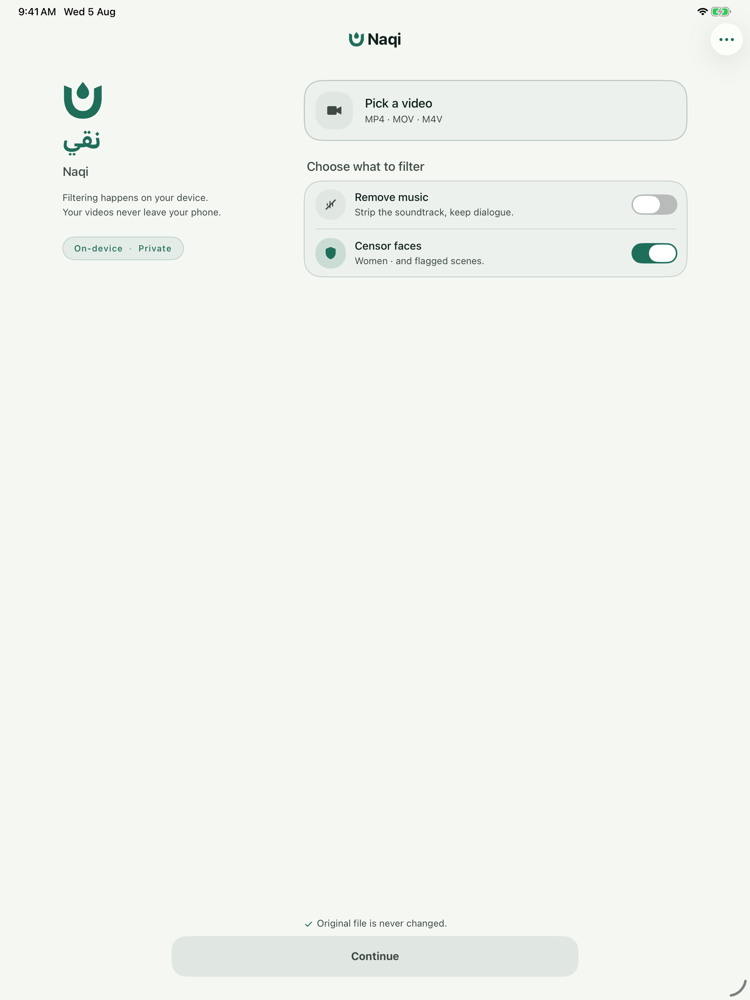
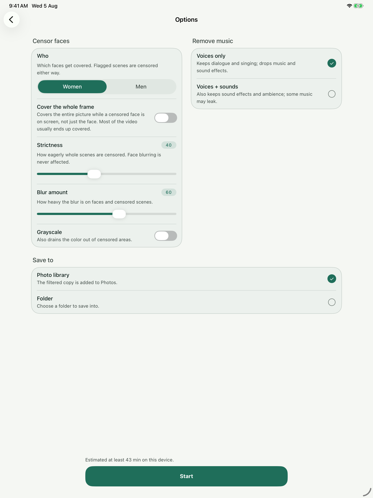
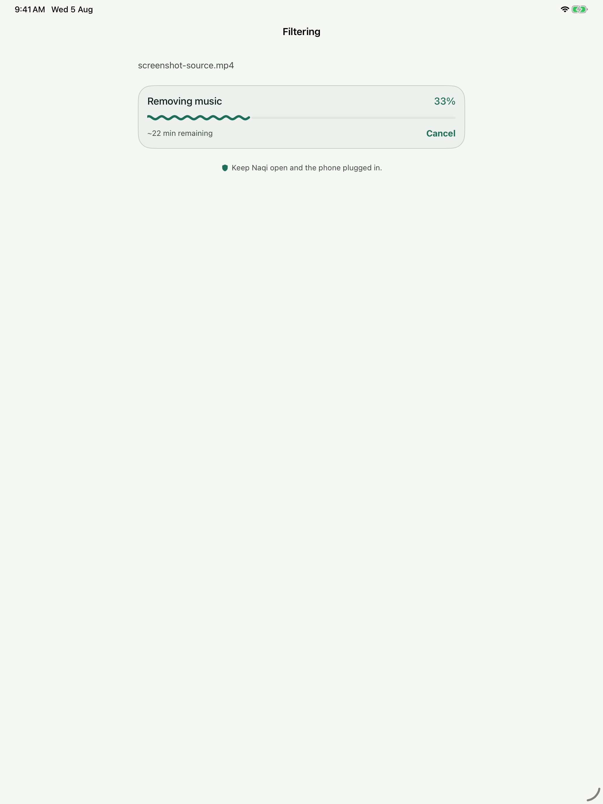
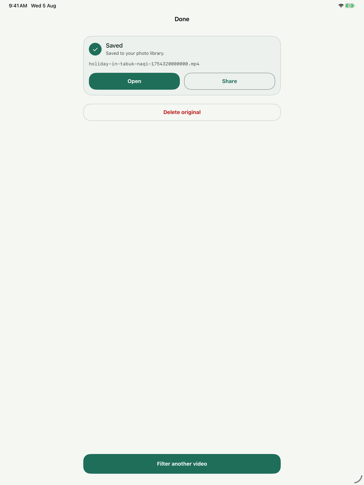

<p align="center">
  
</p>

<h1 align="center">Naqi — Halal Video Filter</h1>

<p align="center">
  iPhone, iPad and Mac app that filters video <b>on-device</b>: removes music from the audio and
  censors faces or bodies in the picture.<br>
  No accounts, no uploads. The original file is never modified.
</p>

<p align="center">
  <a href="https://apps.apple.com/app/id6798173054"></a>
  <a href="LICENSE"></a>
  
  
</p>

<p align="center">
  <b>English</b> · <a href="README.ar.md">العربية</a>
</p>

<p align="center">
  🤖 Also on Android: <a href="https://github.com/haithamassoli/NaqiHalalVideoFilter"><b>Naqi for Android</b></a>
</p>

*Naqi (نقي) means "pure" in Arabic.*

<p align="center">
  
  
  
  
  
</p>

## What it does

Two independent operations, run alone or together:

- **Remove music** — HTDemucs stem separation splits the audio and keeps only the stems you choose
  (`vocals`, or `vocals + other` to retain sound effects at the cost of some music leakage).
  Speech and singing stay, because to a stem separator they are the same thing. A YAMNet gate
  checks for music first, so music-free stretches skip separation.
- **Censor people** — Vision finds and tracks faces, and an InsightFace `genderage` vote resolves
  each track. You pick **who** gets covered: everyone, women, or men. People who cannot be
  classified are covered.

Coverage can be **Face / Body / Precise body**. Face is the default. Both body options add
YOLO11n-seg at 10 fps and are slower: Body covers a rectangle around the person, Precise body covers
the person's outline and keeps the background visible.

Independently of people, an optional **NSFW scene gate** covers the entire frame while it fires, with
pre-roll so nothing slips through on the first frame.

Adjustable: who gets censored, blur amount, a solid fill instead of blur (5 colours), grayscale,
whole-frame mode, and the scene gate's on/off plus strictness (0–100).

Also included:

- **Import anywhere** — Photos, Files, the share sheet, or drag and drop on Mac.
- **Download by link** — paste or share a video URL and Naqi fetches it, then filters it. Pick the
  quality (best / 1080p / 720p / 480p / audio-only). The download lands in a quarantine directory
  and is only published once filtered.
- **Audio files too** — music removal works on audio without any video.
- **Resumable jobs** — progress is checkpointed, so an interrupted job picks up where it stopped.
  A Live Activity shows a running job on the Lock Screen.
- **English and Arabic**, with a full right-to-left layout in Arabic.

Input formats: anything Apple's decoders read (MP4, MOV, M4V and more), plus WebM, which becomes an
MP4 working copy first. MKV is not supported.

## Privacy

Imported files are processed locally. The network is used only to fetch media from a link you
give it. Nothing is uploaded, and no account is required. The full privacy statement is in the app
under About.

## Install

<a href="https://apps.apple.com/app/id6798173054"></a>

Free on the App Store for iPhone and iPad. The Mac app is built from source (below).

**Requirements:** iOS / iPadOS 18 or newer, or macOS 15 or newer for the Mac build.

## Build from source

You need a Mac with Xcode and the iOS 18 / macOS 15 SDKs. The project uses Swift 6 and resolves
ONNX Runtime and the FFmpegKit min build through Swift Package Manager.

The models and fonts are gitignored. A fresh clone needs three things first:

1. **Models from the Android project.** Clone
   [NaqiHalalVideoFilter](https://github.com/haithamassoli/NaqiHalalVideoFilter), fetch its models,
   then point the script at the checkout:

   ```sh
   python3 -m pip install numpy onnx onnxruntime
   NAQI_ANDROID_REPO=/path/to/NaqiHalalVideoFilter ./scripts/fetch-models.sh
   ```

2. **The Core ML person model.** The script verifies the pinned graph and weights before compiling:

   ```sh
   uv run --python 3.12 --with ultralytics==8.4.29 --with torch==2.7.0 \
     --with torchvision==0.22.0 --with numpy==2.2.6 --with coremltools==9.0 \
     scripts/fetch-person-model.py
   ```

3. **Fonts.** Put licensed Thmanyah Sans `Regular`, `Medium` and `Bold` `.otf` files in
   `NaqiShared/Fonts/`, named `thmanyahsans-Regular.otf`, `thmanyahsans-Medium.otf` and
   `thmanyahsans-Bold.otf`.

Then open `naqi.xcodeproj`, select the `naqi` scheme, and run on an iOS simulator or a Mac. From the
terminal:

```sh
xcodebuild -project naqi.xcodeproj -scheme naqi \
  -destination 'generic/platform=iOS Simulator' \
  -derivedDataPath build.noindex/README CODE_SIGNING_ALLOWED=NO build
```

Check the model and font terms before obtaining or distributing them; see [`NOTICE`](NOTICE).

## How it works

Analysis and rendering are two separate passes. The gender vote needs a complete face track before
its first frame can be rendered, and the scene gate's pre-roll needs its timeline ahead of the
encoder.

**Pass 1 (decode only)** samples the NSFW gate at 5 fps and faces at 10 fps, resolves each face
track's gender from up to 5 frontal crops, and emits an EDL: censor intervals plus per-frame
regions.

**Pass 2** replays the EDL through Core Image and encodes with AVAssetWriter on the hardware
encoder. Censor-only jobs pass the audio through untouched; music-only jobs copy the original video
samples with no re-encode.

The architecture mirrors the Android app. More detail lives in
[`docs/prd-video-filter-apple.md`](docs/prd-video-filter-apple.md), and the
[iOS integration report](docs/benchmarks/integration-ios.ar.md) has the full-video performance
comparison and remaining coverage limits.

### The models

| Model | Job | Size | Runtime |
| --- | --- | --- | --- |
| [htdemucs](https://github.com/facebookresearch/demucs) (2.6 s segment, fp32) | music/vocal stem separation | 173 MB | ONNX Runtime |
| [YAMNet](https://github.com/tensorflow/models/tree/master/research/audioset/yamnet) | "is there music here?" gate before separation | 16 MB | ONNX Runtime |
| [nsfw_model](https://github.com/GantMan/nsfw_model) MobileNetV2 1.4-224 | NSFW scene gate | 17 MB | ONNX Runtime |
| [InsightFace](https://github.com/deepinsight/insightface) `genderage` (buffalo_l) | per-face-track gender vote | 1.3 MB | ONNX Runtime |
| Apple Vision | face detection and tracking | — | system |
| [YOLO11n-seg](https://docs.ultralytics.com/models/yolo11) (FP16, 640×640) | optional body boxes and silhouettes | 5.8 MB | Core ML |

Licence terms for each model are in [`NOTICE`](NOTICE).

## Accuracy, honestly

The models are good, not perfect. A face never seen frontally may go unresolved, and the gender vote
makes mistakes on partial faces and children. Filtering can miss a face or a scene, so review the
result before sharing it.

If you want the strictest possible result, pick **everyone** rather than a gender, and turn the
whole-frame mode on.

## Licence

The Naqi-authored code is available for **personal, non-commercial use** under
[`LICENSE`](LICENSE). Third-party code, fonts and model weights have their own terms, listed in
[`NOTICE`](NOTICE).
